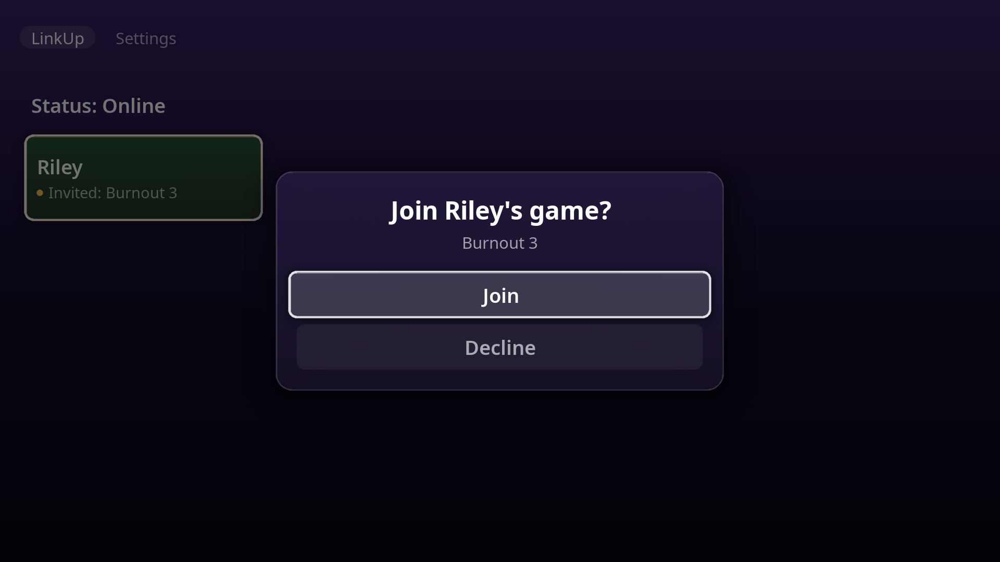
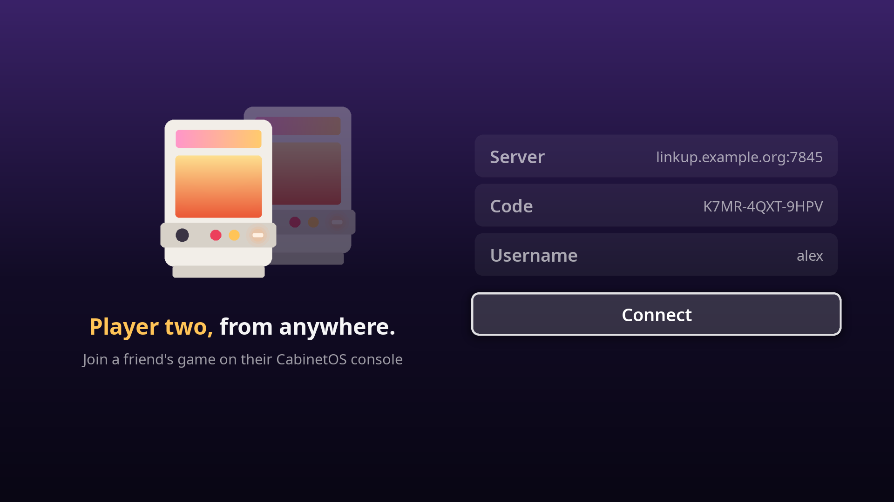
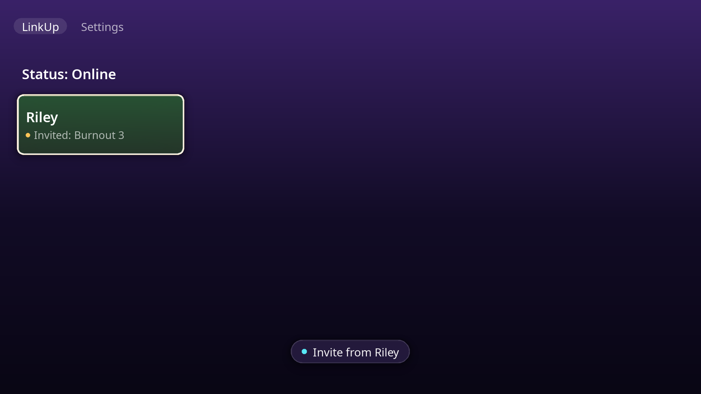
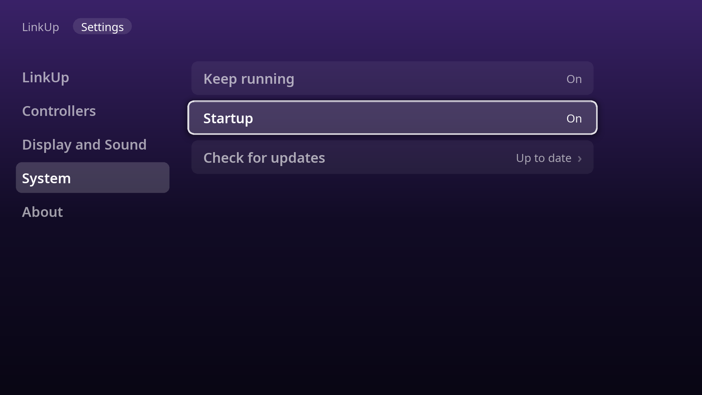

<p align="center"></p>

<h1 align="center">CabinetOS 2P Start</h1>

<p align="center"><b>Player two, from anywhere.</b><br>
A small app for a Mac or a Windows PC that joins a friend's game on their
<a href="https://github.com/MMagTech/cabinetos">CabinetOS</a> console.</p>

<p align="center">
<a href="https://github.com/MMagTech/cabinet-linkup-guest/releases/latest"><b>Download</b></a> ·
<a href="#installing">Install</a> ·
<a href="https://github.com/MMagTech/cabinetos/blob/main/docs/wiki/linkup.md">LinkUp</a>
</p>



2P Start is for a friend who has no CabinetOS console. Your friend hosts the
game on their console with LinkUp, and 2P Start shows it on your computer, with
its sound, while you play as player two with your own controller. It only
joins, and never hosts. The games, the saves and the library stay on your
friend's console, and you need none of them.

- **Pair once.** Your friend's LinkUp server and a code, and you are in their
  friends list from then on.
- **Invites reach you with the window closed.** It waits in the tray or the
  menu bar, and an invite comes as a notification with Join and Decline on it.
- **The picture your computer's graphics chip decodes**, in H.265 where it can,
  as a console takes it, and H.264 everywhere else.
- **Your own controller**, or a keyboard and mouse. Every box copies and
  pastes as any app's does, with the keys or a right-click.
- **The console's own LinkUp**: its screens, its words, its sixteen colours and
  its sounds.
- **It says when there is a new version**, from Settings, Check for updates.

| | | |
|---|---|---|
|  |  |  |

The pictures are from the app's gallery, with made-up friends.

## Why it exists

CabinetOS is a console under a TV, and that does not change. But not every
friend can give a PC over to one. 2P Start is a thank-you to the people who
run CabinetOS: a handful of quarters to hand a buddy. You bring the console
and the games. They just press Start.

## What you need

- **A friend with a CabinetOS console** and LinkUp on, and from them, their
  LinkUp server's address and a code for you. Whoever runs the server makes the
  code on its People page.
- **A Mac with Apple silicon** (M1 or later) on macOS 13 or later, or **a PC
  with Windows 10 or 11**, 64-bit.
- **A controller**, or a keyboard and mouse.

## Installing

2P Start is free, and not signed by Apple or Microsoft, so the first time it
opens, the computer warns about it. That is expected. Each way below gets past
it once: by clicking, or with one line to copy and paste.

### On a Mac

1. Download `2P-Start-…-Mac.dmg` from
   [Releases](https://github.com/MMagTech/cabinet-linkup-guest/releases/latest)
   and open it.
2. Drag 2P Start onto Applications.
3. Open 2P Start from Applications. The Mac says it can't check it: press Done.
4. Open System Settings, then Privacy & Security. Near the bottom, beside
   "2P Start was blocked", press Open Anyway, and give your password.

Or, in place of steps 3 and 4: open Terminal (in Applications, Utilities),
paste this line, and press Return. It takes away the mark that says 2P Start
came from the internet, for 2P Start alone.

```bash
xattr -dr com.apple.quarantine "/Applications/2P Start.app"
```

When it asks to send notifications, press Allow: that is how an invite reaches
you with the window closed. To update, quit 2P Start from its menu bar icon
first, or the Mac opens the one still running; then do steps 1 to 4 again, or
the line again.

### On Windows

1. Download `2P-Start-…-Windows-Setup.exe` from
   [Releases](https://github.com/MMagTech/cabinet-linkup-guest/releases/latest)
   and open it.
2. Windows says "Windows protected your PC": press More info, then Run anyway.
3. Press Install. It goes in the Start menu, for you alone, with no
   administrator password.

Or, before you open it: right-click the Setup, Properties, tick Unblock, and
press OK. Or open PowerShell, paste this line, and press Return. Either way,
Windows asks nothing when it opens.

```powershell
Get-ChildItem "$HOME\Downloads\2P-Start-*-Windows-Setup.exe" | Unblock-File
```

To update, open the newer Setup the same way: it puts the new 2P Start over
the old one, and keeps your pairing.

### The first time it opens

It asks for your friend's LinkUp server, the code, and a name. Then your
friend's console lists you, and you see your friends. Keep the code: it is
yours now. On another computer, or after removing 2P Start, pair with it again
and your friends are there. Closing the window
leaves 2P Start running, in the tray or the menu bar, so invites still reach
you; Settings, System, Keep running changes that.

### Removing it

On Windows: Settings, Apps, 2P Start, Uninstall. It takes 2P Start and its
Startup entry, and asks whether to remove your pairing and settings too.

On a Mac: quit 2P Start from its menu bar icon, and drag it from Applications
to the Trash. Your pairing and settings stay, in the folder
`~/Library/Application Support/CabinetOS 2P Start`, for if you put it back;
drag that to the Trash too to remove them.

## Thanks

2P Start stands on other people's work.

- **[CabinetOS](https://github.com/MMagTech/cabinetos)**'s own LinkUp code is
  built into it as it is written, so 2P Start speaks LinkUp exactly as a
  console does.
- **[GStreamer](https://gstreamer.freedesktop.org)** brings the game's picture
  and sound across, and **[SDL](https://www.libsdl.org)** draws the window and
  reads the controller.

Thank you to everyone who works on them.

## Credits and licence

2P Start's own source is MIT licensed. See [`LICENSE`](LICENSE). Each package
carries the licence of every part inside it, in `licenses`, and Settings,
Credits names them all. The font is Noto Sans, under the SIL Open Font Licence
beside it in `assets/fonts`.

## Working on 2P Start

- [`CONTRIBUTING.md`](CONTRIBUTING.md): the rules, where it stands, building
  it on a Mac and on Windows, the packages, what CI checks, and releases.
- [`docs/ARCHITECTURE.md`](docs/ARCHITECTURE.md): the map of the code, what
  each part must never do, and each system's own places, for a 2P Start on
  another system.
- [`docs/decisions/`](docs/decisions/README.md): what was decided, and why.
- [`AGENTS.md`](AGENTS.md) for AI tools, and [`CLAUDE.md`](CLAUDE.md) for
  sessions with the maintainer.
